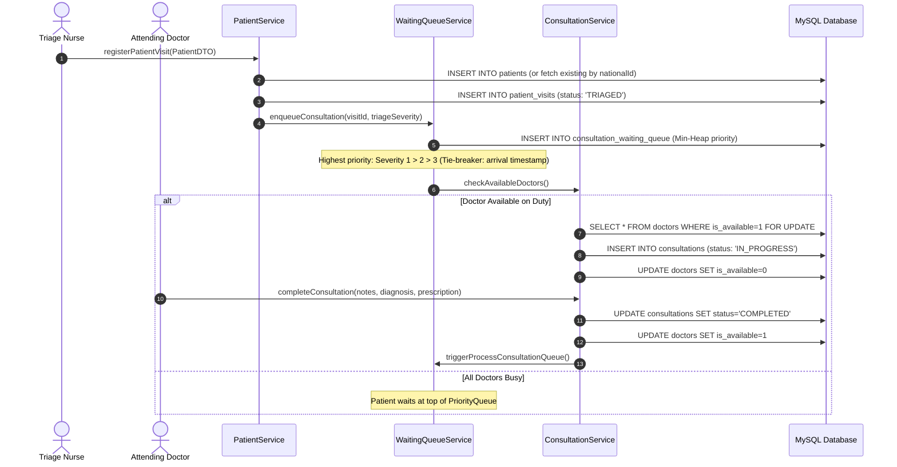
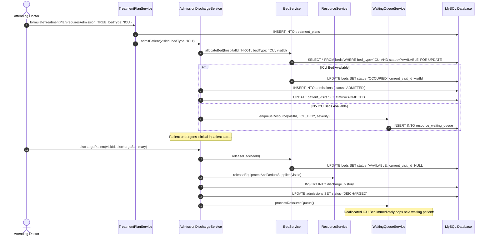
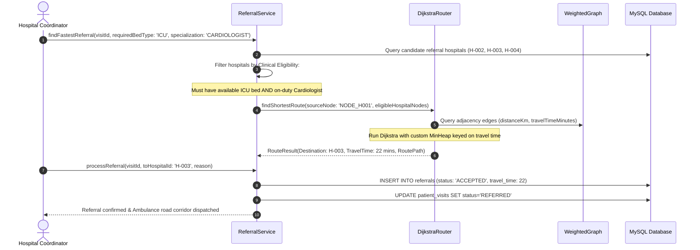

# Unified Modeling Language (UML) Diagrams: GHRAS

---

## 1. Object-Oriented Architecture Overview

The **Government Hospital Resource Allocation System (GHRAS)** is designed strictly adhering to the fundamental principles of Object-Oriented Programming (OOP):
- **Abstraction:** Defined through core business interfaces such as `Allocatable`, `AdmissionPolicy`, `ResourceAllocationPolicy`, and `RoutePlanner`.
- **Inheritance:** Polymorphic class hierarchies for **Beds** (`Bed` $\rightarrow$ `GeneralBed`, `ICUBed`, `EmergencyBed`), **Resources** (`Resource` $\rightarrow$ `MedicalEquipment`, `MedicalSupply`, `HospitalFacility`), and **Doctors** (`Doctor` $\rightarrow$ `GeneralPhysician`, `SpecialistDoctor`).
- **Polymorphism:** Runtime dynamic method dispatch through the `Allocatable` interface (`allocate()`, `release()`, `isAvailable()`, `getResourceIdentifier()`), and custom validation routines across different bed and resource subtypes.
- **Encapsulation:** Strongly typed private fields with validated public accessors and mutators across all domain models and DTOs.
- **Composition:** The `Hospital` entity models the physical hospital by composing collections of `Doctor`, `Bed`, `Resource`, and `DiagnosticService` instances.

---

## 2. Core Class Diagram (Mermaid)

```mermaid
classDiagram
    class Allocatable {
        <<interface>>
        +allocate(String patientId, String visitId) boolean
        +release() boolean
        +isAvailable() boolean
        +getResourceIdentifier() String
    }

    class Bed {
        <<abstract>>
        -String bedId
        -String bedNumber
        -String wardNumber
        -String bedType
        -String status
        -String hospitalId
        -String currentPatientId
        -String currentVisitId
        -LocalDateTime allocatedTime
        +allocate(String patientId, String visitId) boolean
        +release() boolean
        +isAvailable() boolean
        +getBedId() String
    }
    Allocatable <|.. Bed

    class GeneralBed {
        -boolean oxygenPortAvailable
        -boolean ivStandAvailable
        +allocate(String patientId, String visitId) boolean
    }
    class ICUBed {
        -boolean ventilatorAttached
        -boolean cardiacMonitorAttached
        -boolean suctionUnitAvailable
        +allocate(String patientId, String visitId) boolean
    }
    class EmergencyBed {
        -boolean traumaKitAvailable
        -boolean defibrillatorNearby
        +allocate(String patientId, String visitId) boolean
    }
    Bed <|-- GeneralBed
    Bed <|-- ICUBed
    Bed <|-- EmergencyBed

    class Resource {
        <<abstract>>
        -String resourceId
        -String resourceName
        -String category
        -String hospitalId
        -String status
        -int totalQuantity
        -int availableQuantity
        +allocate(String patientId, String visitId) boolean
        +release() boolean
        +isAvailable() boolean
        +deductQuantity(int qty) boolean
        +replenishQuantity(int qty) void
    }
    Allocatable <|.. Resource

    class MedicalEquipment {
        -String serialNumber
        -String modelNumber
        -String maintenanceSchedule
        +allocate(String patientId, String visitId) boolean
    }
    class MedicalSupply {
        -String batchNumber
        -LocalDate expiryDate
        -String unitOfMeasure
        -int reorderLevel
        +isExpired() boolean
    }
    class HospitalFacility {
        -String roomNumber
        -String floorLevel
        -int operationalCapacity
    }
    Resource <|-- MedicalEquipment
    Resource <|-- MedicalSupply
    Resource <|-- HospitalFacility

    class Doctor {
        <<abstract>>
        -String doctorId
        -String fullName
        -String specialization
        -String doctorType
        -String department
        -boolean onDuty
        -boolean isAvailable
        -int maxDailyPatients
        -int currentActivePatients
        +allocate(String patientId, String visitId) boolean
        +release() boolean
        +isAvailable() boolean
    }
    Allocatable <|.. Doctor

    class GeneralPhysician {
        -String opdClinicRoom
        -boolean acceptsPediatric
    }
    class SpecialistDoctor {
        -String subSpecialtyCertification
        -boolean otPrivileges
    }
    Doctor <|-- GeneralPhysician
    Doctor <|-- SpecialistDoctor

    class Hospital {
        -String hospitalId
        -String hospitalName
        -String locationName
        -int totalBeds
        -boolean isPrimary
        -List~Doctor~ doctors
        -List~Bed~ beds
        -List~Resource~ resources
    }
    Hospital *-- Doctor
    Hospital *-- Bed
    Hospital *-- Resource

    class Patient {
        -String patientId
        -String nationalId
        -String fullName
        -LocalDate dateOfBirth
        -String gender
        -String bloodGroup
        -String contactNumber
    }

    class PatientVisit {
        -String visitId
        -String patientId
        -String triageCategory
        -int triageSeverity
        -String status
        -LocalDateTime registrationTime
    }
    Patient "1" *-- "*" PatientVisit

    class Consultation {
        -String consultationId
        -String visitId
        -String doctorId
        -String clinicalNotes
        -String prescription
        -String status
    }
    PatientVisit "1" *-- "1" Consultation

    class TreatmentPlan {
        -String planId
        -String visitId
        -String doctorId
        -String treatmentPathway
        -boolean requiresAdmission
        -String requiredBedType
    }
    PatientVisit "1" *-- "1" TreatmentPlan

    class Admission {
        -String admissionId
        -String visitId
        -String bedId
        -String status
        -LocalDateTime admissionTime
        -LocalDateTime dischargeTime
    }
    PatientVisit "1" *-- "0..1" Admission
```

---

## 3. Sequence Diagram 1: Patient Triage & Consultation Lifecycle

---

## 4. Sequence Diagram 2: Inpatient Admission, Bed Allocation & Discharge

---

## 5. Sequence Diagram 3: Inter-Hospital Referral with Dijkstra Routing

